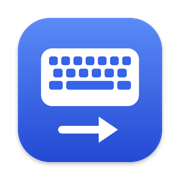

<p align="center">
  <a href="https://gethop.vercel.app"></a>
</p>

<h1 align="center">Hop</h1>

<p align="center">
  <b>Use your Mac's keyboard and trackpad on your Windows PC.</b><br>
  Press ⌃⌥⌘→ and you're on the PC; ⌃⌥⌘← brings you back. Hop also shows the PC's screen in a window on your Mac.
</p>

<p align="center">
  Free and open source (GPL-3.0). No account, no cloud: just your two computers on your home network.
</p>

<p align="center">
  <a href="https://github.com/hmzakhalid/hop/releases/latest/download/Hop.dmg"><b>Download for Mac</b></a> ·
  <a href="https://github.com/hmzakhalid/hop/releases/latest/download/Hop-Setup.exe"><b>Download for Windows</b></a> ·
  <a href="https://gethop.vercel.app">Website</a> ·
  <a href="docs/USER_GUIDE.md">User guide</a>
</p>

## What it does

- **One keyboard, two computers:**
  - Press ⌃⌥⌘ plus the arrow toward the PC, or push the pointer past the screen edge.
  - A blue badge on the Mac shows when the PC has control.
- **Mac shortcuts just work:**
  - ⌘C, ⌘V, ⌘Z and ⌘S work as Ctrl.
  - ⌘Tab switches apps, ⌥← jumps words, ⌃L locks the PC.
- **The whole PC:** the sign-in and lock screens, admin prompts, Task Manager and games, through a small Windows service.
- **See the PC on your Mac:** a live window of the PC's screen, streamed with the PC's graphics card (HEVC or H.264).
- **Fast:** about 5 ms round trip on home Wi-Fi. Hop's own overhead is about 0.1 ms per side, and it uses about 0.2% CPU.
- **Safe:**
  - If the PC stops answering, the Mac takes its keyboard back within half a second.
  - No key ever stays stuck on the PC.
  - Password fields on the Mac never cross over.
- **Private:**
  - Paired with a one-time code, and end-to-end encrypted (Noise IK, ChaCha20-Poly1305).
  - Your Mac talks to your PC directly: nothing goes through a server.

## Set up (about 2 minutes)

You need a Mac with macOS 14 or later (Apple silicon or Intel), a PC with Windows 10 or 11, and both on the same network.

1. **On the PC:**
   1. Download and run [**Hop-Setup.exe**](https://github.com/hmzakhalid/hop/releases/latest/download/Hop-Setup.exe).
   2. If Windows says *"Windows protected your PC"*, click **More info → Run anyway**. Hop isn't code-signed yet.
   3. At the end, leave **Pair a Mac now** ticked. A window shows a code like `7KQ2-M9XD-4TRB`.
2. **On the Mac:**
   1. Download [**Hop.dmg**](https://github.com/hmzakhalid/hop/releases/latest/download/Hop.dmg), open it, and drag Hop to Applications. Then open Hop.
   2. If macOS says it can't verify Hop, click **Done**. Then go to **System Settings → Privacy & Security**, scroll down, and click **Open Anyway**. You do this once.
   3. Turn on Hop under **Accessibility** when asked. Hop finds your PC and asks for the code: type it in.
3. **Press ⌃⌥⌘→.** Your keyboard and pointer are on the PC. ⌃⌥⌘← brings them back.

The [user guide](docs/USER_GUIDE.md) covers every key, setting and fix.

## Measured

| | Result |
|---|---|
| Hop's own overhead | About 0.1 ms per side (0.22–0.31 ms loopback round trip) |
| MacBook (Wi-Fi) to Windows PC (Wi-Fi), same home network | Round trip p50 5.3 ms, p99 9 ms, 0% loss |
| Screen view, 4K HEVC over home Wi-Fi | About 20 ms from capture to arrival on the Mac |
| Memory | Mac app 12 MB; PC agent 7.5 MB working set |
| CPU | About 0.2% on each side during use |

## For developers

Everything builds on a Mac (Rust 1.86+):

```
cargo test --workspace                     # the test suite
tools/loopback-rig.sh                      # pair and drive a dry-run agent on this Mac, no PC needed
packaging/macos/build.sh                   # → dist/Hop.app and dist/Hop-<version>.dmg
brew install mingw-w64 makensis && rustup target add x86_64-pc-windows-gnu
packaging/windows/build.sh                 # → dist/Hop-Setup-<version>.exe
packaging/release.sh                       # both, checked for leaks, ready for a GitHub release
```

| Document | What it covers |
|---|---|
| [docs/USER_GUIDE.md](docs/USER_GUIDE.md) | Setup, keys, switching, screen view, speed tips, troubleshooting, the command line |
| [docs/ARCHITECTURE.md](docs/ARCHITECTURE.md) | The crates and modules, how input flows, the threads, and where each kind of change goes |
| [docs/PROTOCOL.md](docs/PROTOCOL.md) | The wire format, pairing, sessions, state repair and the safety timers |
| [docs/WINDOWS_SERVICE.md](docs/WINDOWS_SERVICE.md) | The service: what it does, its security model, install and uninstall |
| [docs/TESTING.md](docs/TESTING.md) | The test suite, testing on a real PC without typing into it, and latency measurement |
| [docs/RELEASE.md](docs/RELEASE.md) | Building, signing and publishing a release |
| [docs/decisions/](docs/decisions/) | Why the code is shaped the way it is, and the special cases kept on purpose |
| [site/](site/) | The website (static, no build step) |

Bug reports and pull requests are welcome. Please run `cargo test --workspace` first, and say which macOS and Windows versions you tried.

## License

Hop is free software: you can redistribute it and modify it under the terms of the [GNU General Public License](LICENSE), version 3 or (at your option) any later version. Hop is distributed in the hope that it will be useful, but WITHOUT ANY WARRANTY.

Hop is not affiliated with Apple or Microsoft. Mac and macOS are trademarks of Apple Inc.; Windows is a trademark of Microsoft Corporation.
